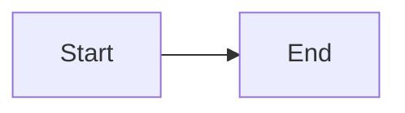

# Descriptions, comments, mentions and references

## Descriptions and comments

- Descriptions are Markdown by default and sent as HTML. Minka keeps every
  heading level, bold, italic, strikethrough, inline code, links with titles,
  lists (numbered ones also from another start), quotes, code blocks with
  their language, tables, horizontal rules and the shapes of a document (see
  below). Images become links, links
  other than http, https, mailto, tel and relative ones become plain text.
  These changes are reported in `notice`, and on stderr for text output and
  `--quiet`.
- Markdown that holds text but nothing Minka keeps (only link reference
  definitions, for example) is refused, so it cannot remove a description by
  accident. To remove a description, give `--description ""`.
- `--description-format html` sends HTML as it is; the server sanitizes it.
- HTML inside Markdown is sent as visible text, in a code block, with a
  `notice`. A text that is mostly HTML is refused (exit 1, `usage`) and nothing
  is sent: give the command's format flag with `html`, or put HTML meant to be
  shown into a fenced code block between lines of three backticks.
- **HTML that carries no element Minka serves is not refused.** It is escaped
  and kept as the characters it consists of, with the same answer as any other,
  so Markdown sent with `--description-format html` or `--format html` stands
  there afterwards as `# Heading`. The command says so in a `notice`, and
  nothing else will.
- Every text comes twice: stored (`description`, `body`, `bodyHtml`) and as
  its source (`descriptionSource`, `bodySource`). Files and mentions stand in
  the source as `<action-text-attachment>` elements with fresh signatures and
  their `url`, `filename` and `content-type`. `cards show --styled` shows a
  picture as a Markdown image, a file as a link and a mention as `@Name`.
- Markdown cannot hold files or mentions, nor `<minka-embed>` for an address
  Minka drew as a card; a `<minka-ref>` it holds only as its address (see
  "Pointing at a card or another record"). To change a description that has any
  of them, take `descriptionSource` from `minka cards show <cardId> --quiet`,
  change it and send it back with `cards edit --description - --description-format html`.
  A new description that would drop them is refused (exit 1) unless
  `--drop-attachments` is given — the refusal calls them all attachments,
  after the flag. This holds for every text below and in the other references
  as well. Where Minka refuses
  the write anyway — an archived project, a card, post, document, list or
  to-do in an archive, somebody else's comment — there is no exit 1: Minka's
  own refusal comes, and `--drop-attachments` would change nothing about it.
- `cards show --styled` prints the description as Markdown, which can be edited
  and sent back with `cards edit --description -`.
- Comments and messages carry `reactions`: `[{content, people}]`, the same
  content counted together, in the order it was first left in, and an empty
  array where nobody reacted. `content` is mostly an emoji but may be up to 20
  characters of text. `cards show --styled` and `messages list --styled` put
  them in a line under the comment or the message.
- `comments react <cardId> <commentId> <content>` and `messages react <chatId>
  <messageId> <content>` leave a reaction, `comments unreact` and `messages
  unreact` take one away. A reaction is an emoji or at most 20 characters;
  longer exits 9 with `reactionTooLong`, empty with `reactionMissing`, one with a
  control character in it with `reactionHasControlCharacters`.
- Reacting the same way twice changes nothing and succeeds. Taking one away is
  not bound to whoever left it: it takes your own reaction of that text, and
  where you left none, the one somebody else left last. Taking away what is
  not there succeeds as well.
- A message of a private conversation takes a reaction the same way, under the
  ID of the conversation; somebody outside the two exits 2.
- Comments are rich text like descriptions. `comments create` converts
  Markdown and keeps every line break, so plain text arrives as typed;
  `--format html` sends HTML as it is. `cards show --styled` shows comments as
  Markdown; older comments without markup come back as plain text and are
  shown as they are.
- `comments edit <cardId> <commentId>` and `comments delete` work on your own
  comments only; somebody else's exits 2. A removed comment leaves nothing
  behind, so a second delete exits 2 as well. Like `cards edit`, `comments
  edit` refuses a new text that would drop attachments or mentions unless
  `--drop-attachments` is given; send the comment's `bodySource` back with
  `--format html` to keep them.

## The shapes of a document

Minka keeps these in every text and draws them on a document's page. They are
written and shown in Markdown like this, so a text read with `--styled` can be
sent back as it is:

````markdown
> [!NOTE] Optional title
> A callout. The kinds are NOTE and WARNING; other alerts stay quotes.



<!-- minka:tiles -->
- <https://minka.example/go/card/MNK-1> Words that say what it is
- #MNK-2 A card by its short identifier

<!-- minka:variables -->
| Name | Label | Hint | Default | Staging | Production |
| --- | --- | --- | --- | --- | --- |
| node_name | Node | e.g. wk-1 |  | wk-s | wk-a |

Drain {{node_name}} first.
````

- A callout is a GitHub alert; the title beside the marker is optional.
- A diagram is a code block of the language `mermaid`; the page draws it.
  Every code block is stored the way the editor stores one.
- Link tiles are a list right under `<!-- minka:tiles -->`. Each line starts
  with the address of a record of the same Minka (or a card's `#MNK-1`),
  which Minka turns into a reference; the rest of the line describes it. An
  address of another host, or of a record you cannot see, becomes two
  paragraphs instead. A
  line without such a start is written as a paragraph between two groups, and
  a list item of more than one block makes the whole list a plain list; both
  come with a `notice`.
- A block of variables is a table right under `<!-- minka:variables -->`:
  the columns name, label, hint and default, then a value per profile, the
  profile's name heading its column. The header words are free; only the
  order counts. `{{name}}` in the text and in code stands for the value a
  reader picks on the page; Minka stores the placeholder, never a value.
- A marker anywhere else is sent as visible text, with a `notice`; so is a
  variables marker inside a callout, where Minka keeps no such block. An
  empty tile line is left out, with a `notice`.
- To point at a section of a document, write its address with the
  heading's anchor, bare or in angle brackets:
  `<https://…/files/<toolId>/<documentId>#h-setup>` or
  `<https://…/go/item/<documentId>#h-setup>`. Minka keeps it as a reference
  to that section: it reads as the document's title, opens the page at the
  heading and counts as a backlink; read back, it is the address with the
  anchor again. A link with words of its own
  (`[Setup](https://…#h-setup)`) stays a mere link. The anchor is `h-` and
  the heading in lower case, umlauts spelled out, accents dropped, other
  characters a dash, a repeat counted on (`h-setup-2`); `minka search` names
  it for a hit, and `docs export` writes it above every heading.

## Naming somebody in a text

- `people list <projectId>` and `conversations people <conversationId>` give
  every person a `kind` (`human`, `agent` or `bot`), a `principal` (the human
  an agent acts for, otherwise null) and a `mention: {handle, markup}`. An
  agent that stepped down is in no such list any more, however long its name
  stands on what it once wrote. `markup` is the
  `<action-text-attachment>` element that names them.
- Put the markup into a text unchanged and send it as HTML — Markdown cannot
  hold it:

```bash
MARKUP=$(minka people list <projectId> --quiet | jq -r '.[] | select(.name == "Anke") | .mention.markup')
printf '%s please have a look' "$MARKUP" | minka comments create <cardId> - --format html
```

- The person named is notified and becomes a subscriber of the card.
- A mention holds in the circle it was asked for: one of a project belongs in
  texts of that project, one of a conversation in that conversation. Anywhere
  else the server drops it while saving, without an error.
- `cards show --styled` and `messages list --styled` show a mention as `@Name`.

## Pointing at a card or another record

- Write `#MNK-1` for a card with a short identifier, `#ENT-14` or its
  `shortUrl` for a decision with one, or paste the address of a
  card, a post, a chat, a chat line (a chat's address ending in
  `#chat-message-…`), a to-do, a to-do list, a document, an upload, a
  check-in question or a calendar event of the same Minka — in the words or
  as `<address>`. A line of a private conversation counts as well
  (`/messages/<id>#chat-message-…`); the conversation's address alone
  (`/messages/<id>`) is no reference.
  On saving, Minka turns each into a `<minka-ref>` for every way in: Markdown,
  HTML, comments, messages. `MNK-1` without `#`, anything in code, a link with
  words of its own (`[the card](…)`, `[MNK-1](…/go/card/MNK-1)` as well), an
  address of another host and a target you cannot see stay as written: they
  link nothing back.
- A card is always its whole short identifier with `#`: `#MNK-K5`, never `K5`,
  which nobody can follow and Minka cannot link. A number that names no record
  of Minka (package 4, question 2, lane A, P0, step 3 of a plan on the back)
  comes with a few words saying what it is: "package 22 (sweeping up the raw
  buttons and fields)". The yardstick is a reader who has not seen the card's
  back.
- Every answer adds what the reader needs to the element: `title`, `short-id`
  for a card that has one, and `href`. `--json` hands the text over exactly as
  served; sending it back as HTML is safe, because saving keeps only `kind` and
  `id`.
- `--styled` shows a visible reference as its address, `<https://…>`, for
  every kind, so the text stays editable: sent back as Markdown, a link showing
  its own address becomes the reference again. A card's short identifier reads
  in `/go/card/MNK-1`; the title is not shown — take it from `--json`, where
  every reference carries `title` and `short-id`. A target you cannot open, one
  in the trash or one that does not exist reads `(a card you cannot open)`, and
  likewise a post, chat, chat message, to-do, to-do list, document, file
  (`upload`), question or event; any other kind reads `(a reference you cannot
  open)`.
- The guard against dropping counts references: a new text keeps a visible one
  when it holds its address (in the words or as `<address>`), `#MNK-1` for a
  card, or the element itself. A hidden one is kept only by the element, so an
  edit of its view is refused (exit 1) unless `--drop-attachments` is given;
  send the source back as HTML instead.
- Outside Minka — a commit, a pull request, any other text — name a card by
  its `shortUrl`, or by its `appUrl` where `shortUrl` is null: its board has no
  prefix. A changed prefix redirects, so the short address stays valid.
  Example: `Resolves: https://<host>/go/card/MNK-1`. The text views of a card
  give that same address. A Minka that leaves the field out entirely is
  older; there, build the address from the host and the card's `shortId` as
  `https://<host>/go/card/<shortId>`, where `shortId` is not null. A decision
  is named the same way, by its `shortUrl` (`…/go/decision/ENT-14`) or its
  `appUrl`.
- One comment is named by its `appUrl`: the page of its item with
  `#comment-<id>`, which opens the item scrolled to the comment. Every comment
  carries it, under a card and under any other item, and so does the answer to
  `comments create` and `edit`; the text views give it as `URL:` below each
  comment and below the confirmation of a write. Pasted into a text of Minka,
  it is a reference to the item. A Minka that leaves the field out is older;
  there, name the item instead.
